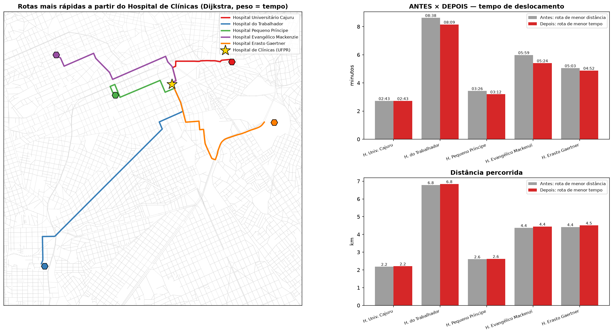
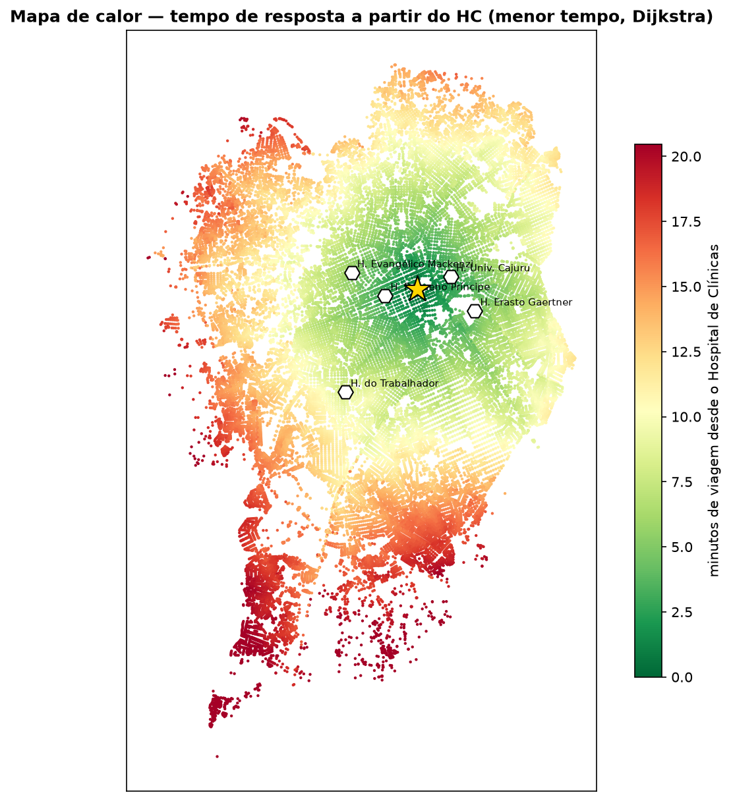

# Projeto 2º Bimestre — Rotas de Emergência em Curitiba

Análise de rotas e tempos de deslocamento entre o **Hospital de Clínicas (UFPR)** e outros hospitais de Curitiba, usando o grafo viário do OpenStreetMap (OSMnx + NetworkX).

## Descrição

O projeto baixa (ou carrega do cache `curitiba_drive.graphml`) a malha viária de Curitiba, estima velocidades por tipo de via e calcula os caminhos de menor tempo da origem até cada hospital. Gera:

- Mapa interativo das rotas (`mapa_rotas_curitiba.html`)
- Mapa de calor (`mapa_de_calor.png`)
- Painel executivo com métricas (`painel_executivo.png`)

## Imagens

### Painel executivo

<!-- Substitua pelo caminho da imagem -->


### Mapa de calor



## Instalação

```bash
git clone https://github.com/dallastinks/projeto-2-bimestre.git
cd projeto-2-bimestre
pip install -r requirements.txt
```

## Uso

```bash
python projeto.py
```

Abra `mapa_rotas_curitiba.html` no navegador para ver o mapa interativo.

## Tecnologias

Python, OSMnx, NetworkX, Folium, Matplotlib, NumPy, Pandas.
